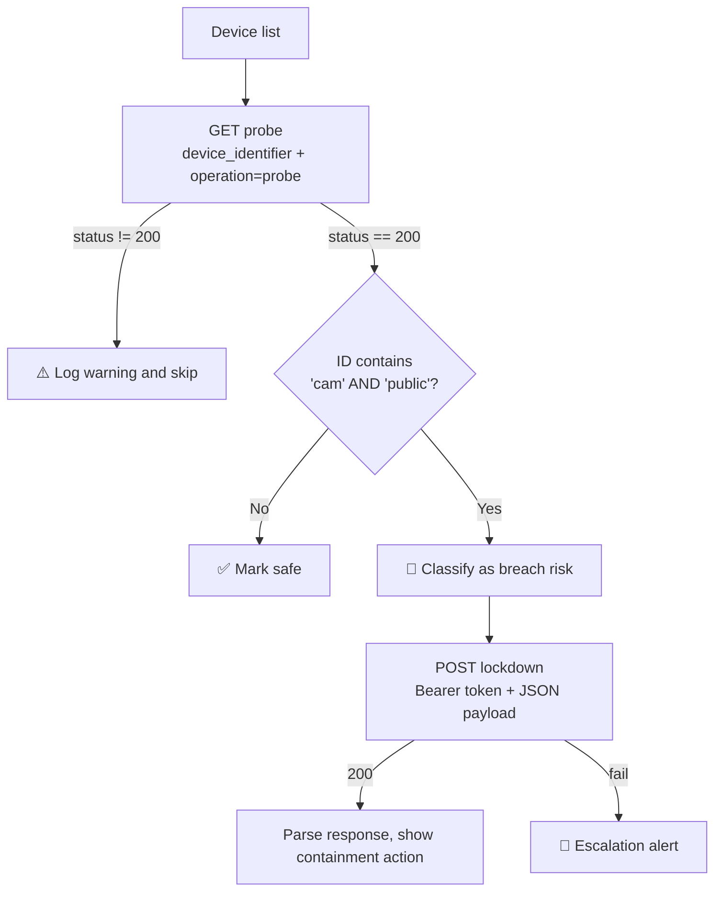

<div align="center">

# 🛡️ Rogue IoT Camera Defense Sweep

**Automated audit → threat assessment → quarantine for IoT devices, built in Python.**


[Overview](#-overview) • [Workflow](#-workflow) • [Quick Start](#-quick-start) • [Output](#-example-output) • [Roadmap](#-roadmap)

</div>

---

## 📌 Overview

A building network is showing unexpected bandwidth from several connected devices. This tool runs a three-stage defense sweep: it **audits** each device, **flags** publicly exposed cameras as compromised, and **quarantines** them through an authenticated API call.

[httpbin.org](https://httpbin.org) acts as a mock device and control API, so the project runs anywhere with no hardware.

## 🔄 Workflow



| Stage | What happens |
|-------|--------------|
| **1. Active Audit** | `GET` probe per device, with ID and mode sent as query parameters |
| **2. Threat Assessment** | Devices with both `cam` and `public` in the ID are flagged |
| **3. Quarantine** | `POST` lockdown with a Bearer token, priority header, and JSON payload, then response validation |

## 🎯 Device Inventory

| Device | Verdict |
|--------|---------|
| `cam-lobby-public` | 🚨 Compromised |
| `sensor-vault-internal` | ✅ Safe |
| `cam-parking-public` | 🚨 Compromised |
| `thermostat-office-internal` | ✅ Safe |

## ✨ Features

- **Fault tolerant:** non-`200` responses and network errors are logged and skipped
- **Precise rule:** requires both `cam` and `public`, so internal cameras are not falsely flagged
- **Authenticated:** `Authorization: Bearer <token>` plus an emergency priority header
- **Validated:** parses the API response to confirm the containment action was applied
- **Escalation alerts** when a lockdown fails
- **Request timeouts** and structured logging (`INFO` / `WARNING` / `ERROR`)
- **Secrets via environment variable**, never hardcoded

## 🚀 Quick Start

```bash
git clone https://github.com/<your-username>/iot-camera-defense-sweep.git
cd iot-camera-defense-sweep
pip install -r requests
python main.py
```

<details>
<summary><b>🔐 Use your own admin token (optional)</b></summary>

```bash
# macOS / Linux
export ADMIN_TOKEN="your-token"

# Windows PowerShell
$env:ADMIN_TOKEN="your-token"
```

If unset, a dummy demo token is used.

</details>

## 🖥️ Example Output

<details open>
<summary><b>Click to expand</b></summary>

```text
INFO | cam-lobby-public classified as COMPROMISED BREACH RISK
INFO | cam-lobby-public isolated - containment action applied: sever_network_access
INFO | sensor-vault-internal is safe
INFO | cam-parking-public classified as COMPROMISED BREACH RISK
INFO | cam-parking-public isolated - containment action applied: sever_network_access
INFO | thermostat-office-internal is safe
```

> Replace with your own terminal output after running the script.

</details>

<details>
<summary><b>📦 Lockdown request payload</b></summary>

```json
{
  "device_identifier": "cam-lobby-public",
  "containment_action": "sever_network_access",
  "agent": "defense-agent-01"
}
```

</details>

## 🗂️ Project Structure

```text
iot-camera-defense-sweep/
├── main.py            # audit, assess, quarantine logic
└── README.md
```

## 🗺️ Roadmap

- [ ] Concurrent scanning with `ThreadPoolExecutor`
- [ ] Retries with exponential backoff
- [ ] Load detection rules from JSON/YAML
- [ ] Export incident reports (JSON/CSV)
- [ ] Unit tests with `pytest` and mocked responses

## 🧠 Skills Demonstrated

`REST APIs` · `Error handling` · `Security automation` · `Incident response logic` · `Secrets management` · `Clean Python`

## 👤 Author

**Asif Sulaman** — [GitHub](https://github.com/<your-username>) • [LinkedIn](https://linkedin.com/in/<your-handle>)
